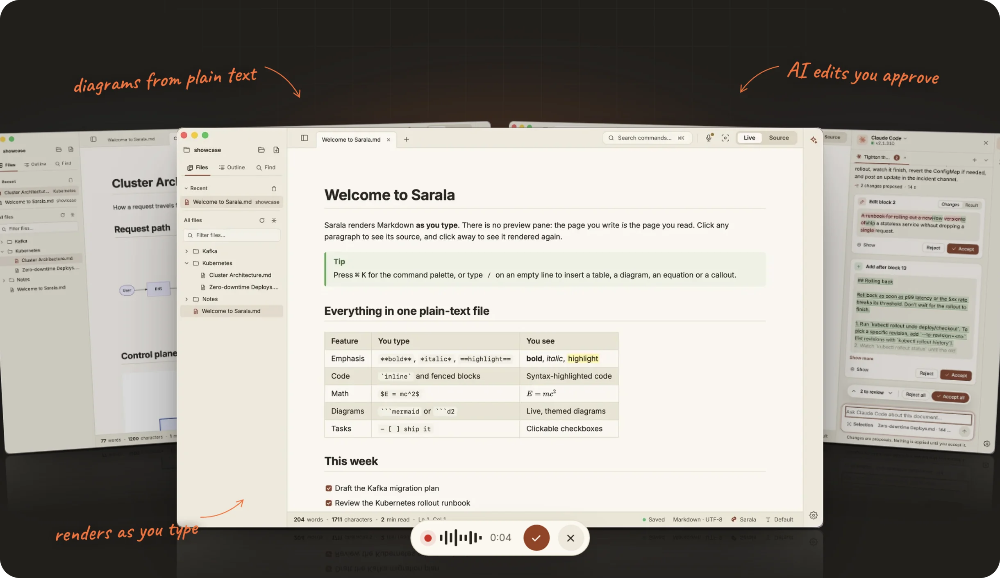
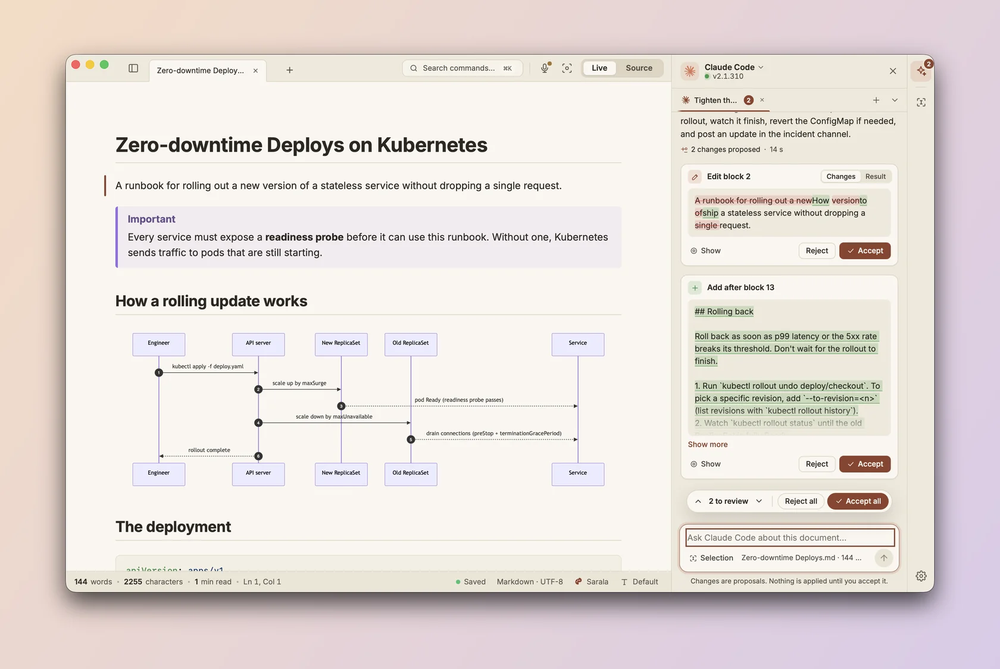
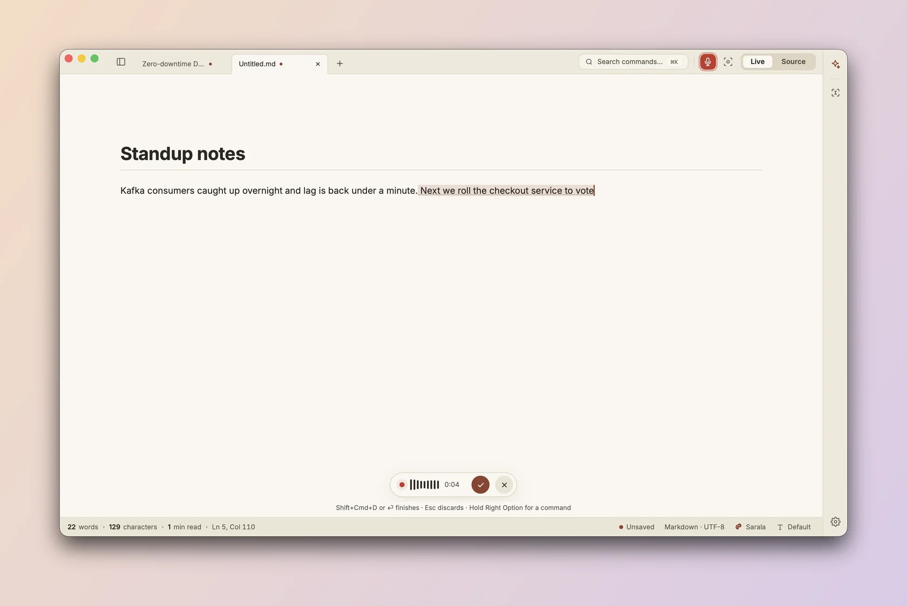
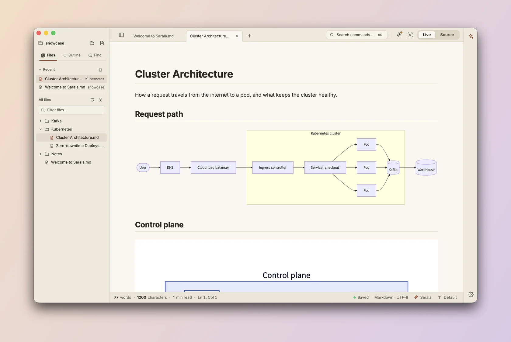
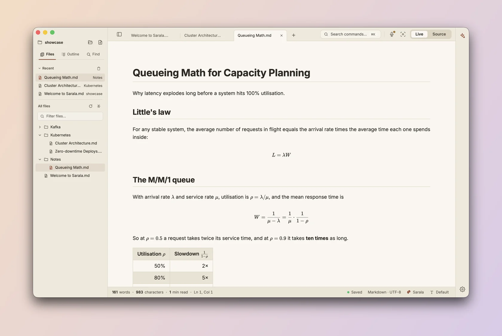
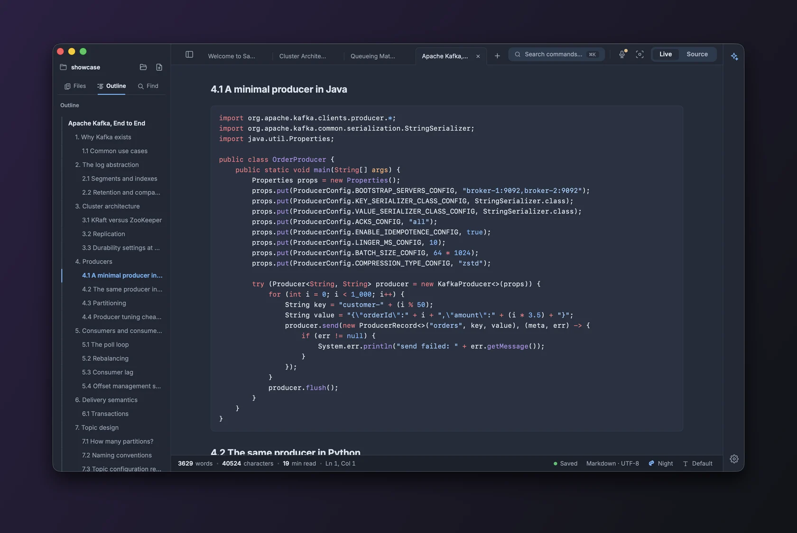
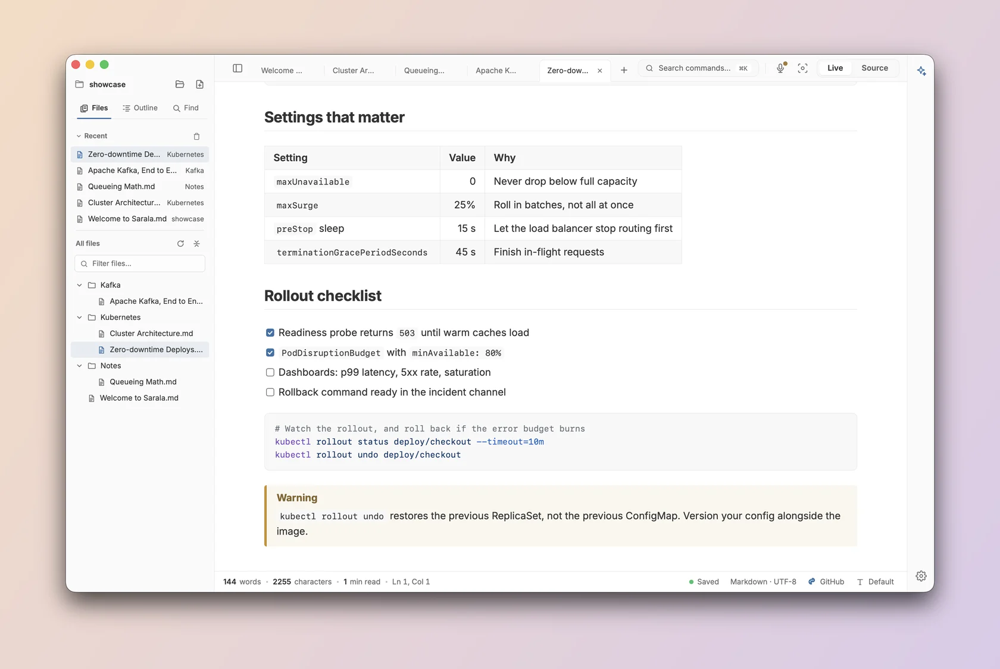
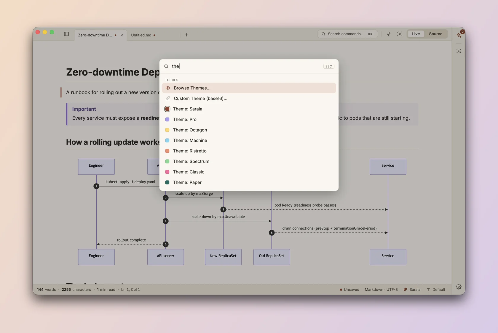
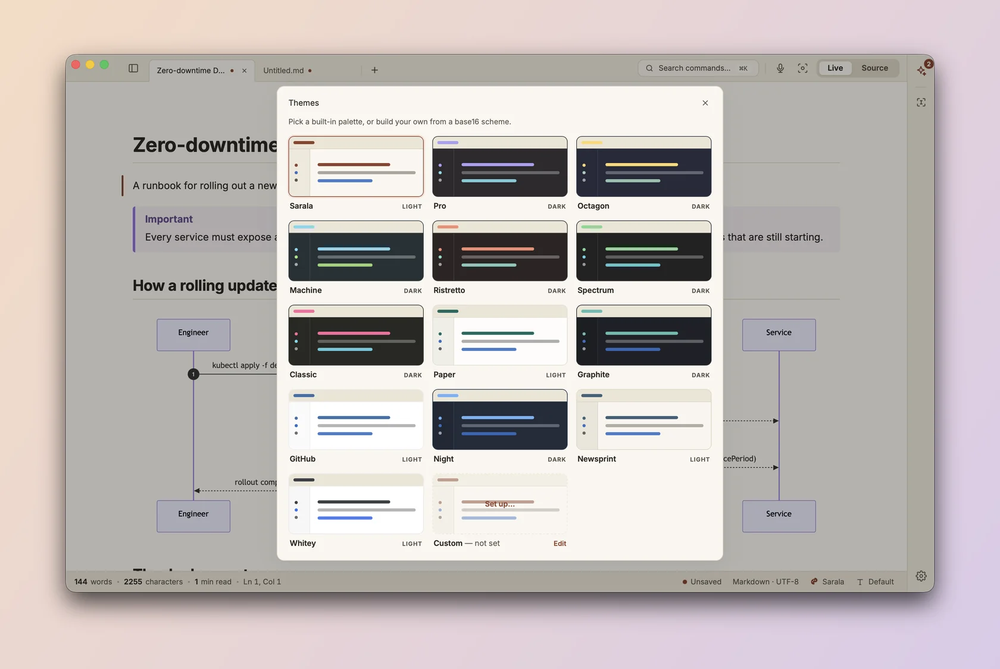

<div align="center">


<h1>Sarala</h1>

**Markdown that reads like a finished document.**

A free, open-source WYSIWYG Markdown editor for macOS, Windows and Linux.<br />
No preview pane, no split view: the page you write *is* the page you read.

[](https://github.com/solancer/sarala/releases/latest)
[](https://github.com/solancer/sarala/actions/workflows/release.yml)
[](https://snapcraft.io/sarala)
[](LICENSE)
[](https://tauri.app)

**[Website](https://sarala.solancer.com)** · **[Download](https://sarala.solancer.com/#download)** · [Release notes](https://github.com/solancer/sarala/releases) · [Build from source](#build-from-source)

<br />



</div>

---

## Why Sarala

- **One page, not two.** Formatting appears the moment you type it. Click any block to edit its Markdown, click away and it renders in place.
- **Plain files you own.** Documents are `.md` files in folders you choose. Open them anywhere, keep them in Git, sync them however you like.
- **Private by default.** No account and no telemetry. Voice typing runs on your computer, and the AI assistant only changes what you approve.
- **Free, with no paid tier.** GPL-3.0, built in the open.

---

## New in 1.3

<table>
<tr>
<td width="50%" valign="top">

<h3>AI assistant</h3>
Ask Claude Code, OpenAI Codex or GitHub Copilot CLI to review, summarise or rewrite. Every change arrives as a word-level diff you accept or reject, and the agent works on a scratch copy, never your file. Sarala uses the agent already installed on your computer, so there are no API keys to manage.
</td>
<td width="50%" valign="top">

<h3>Voice typing, fully offline</h3>
Hold a shortcut and talk. An open speech model on your computer turns it into text: nothing is uploaded, and there's no account. Push to talk or tap to toggle, say "new paragraph" or "scratch that", and set it all up in a minute with a live microphone check.
</td>
</tr>
</table>

---

## A look around

<table>
<tr>
<td width="50%"><br /><sub><b>Diagrams.</b> Mermaid and D2, rendered right in the page.</sub></td>
<td width="50%"><br /><sub><b>Math.</b> LaTeX typeset as you write, with KaTeX.</sub></td>
</tr>
<tr>
<td><br /><sub><b>Code.</b> Highlighting for 100+ languages, in your theme.</sub></td>
<td><br /><sub><b>Tables, tasks and callouts.</b> Edit tables cell by cell, tick tasks with a click.</sub></td>
</tr>
<tr>
<td><br /><sub><b>Command palette.</b> Every action is one <code>Cmd/Ctrl+K</code> away.</sub></td>
<td><br /><sub><b>Themes.</b> Thirteen built in, or your own from any base16 scheme.</sub></td>
</tr>
</table>

---

## Install

### macOS

With [Homebrew](https://brew.sh) (no security prompt, and `brew upgrade --cask sarala` keeps it current):

```bash
brew tap solancer/sarala https://github.com/solancer/sarala
brew trust --cask solancer/sarala/sarala
brew install --cask --yes sarala
```

> `brew trust` is a one-time step: Homebrew 6 refuses casks from third-party taps until you trust them. Older Homebrew has no `trust` command and doesn't need one. The cask needs Homebrew 5.1.14 or newer; `brew update` gets you there.
>
> If `brew install` fails with ``Calling `depends_on macos: :catalina` is disabled``, your tap holds an old copy of the cask: run `brew update` (or `brew untap solancer/sarala` and tap it again), then install.

Or download the universal `.dmg` (Apple Silicon and Intel, macOS 10.15+) from the [latest release](https://github.com/solancer/sarala/releases/latest). Sarala is ad-hoc signed but not notarized by Apple, so macOS blocks the first launch. After dragging it into Applications, run this once:

```bash
xattr -dr com.apple.quarantine /Applications/Sarala.app
```

(Or open it, click **Done**, then **System Settings › Privacy & Security › Open Anyway**.) Sarala registers for `.md`, `.markdown` and `.mdown`, so **Open With › Sarala** works in Finder, including when it's already running.

### Windows

Download the installer (`.exe`) or `.msi` from the [latest release](https://github.com/solancer/sarala/releases/latest). Windows 10 and 11, 64-bit. The installer isn't code-signed yet, so if SmartScreen says **"Windows protected your PC"**, click **More info › Run anyway**.

### Linux

| Format | Install |
| --- | --- |
| [Snap Store](https://snapcraft.io/sarala) | `sudo snap install sarala` |
| `.deb` (Ubuntu, Debian, Mint) | `sudo apt install ./Sarala_<version>_amd64.deb` |
| `.rpm` (Fedora, RHEL, openSUSE) | `sudo dnf install ./Sarala-<version>-1.x86_64.rpm` |
| `.AppImage` (any distribution) | `chmod +x Sarala_<version>_amd64.AppImage && ./Sarala_<version>_amd64.AppImage` |

All from the [latest release](https://github.com/solancer/sarala/releases/latest). Sarala opens `.md` files passed to it, so your file manager's **Open With** works. In-app updates cover the AppImage, `.deb` and `.rpm`; Snap and distribution packages update through their package manager.

---

## What you get

**Writing**

- Live blocks: markers stay visible but dimmed while you type, then the block renders when you leave it
- Smart Enter: continues lists and quotes, auto-numbers, closes a just-opened fence; `Shift+Enter` for a soft break
- Click anywhere in rendered text and the caret lands at that exact spot in the source
- Select text for a formatting bar with a block-type dropdown; type `/` for an insert menu
- IME-safe, so CJK composition works as it should

**Content**

- Full GFM: tables, task lists with clickable checkboxes, strikethrough, footnotes, GitHub alerts, YAML front matter
- Code fences highlighted by [Shiki](https://shiki.style), with light and dark handled through CSS variables
- Math via KaTeX; diagrams via [Mermaid](https://mermaid.js.org) and [D2](https://d2lang.com). A broken one keeps its last good render instead of blanking
- Tables edit in place; hover an edge to add a row or column
- Images resolve relative to the document, with a properties panel for size, alt text and loading

**Getting around**

- Document tabs with independent edits and undo history (`Cmd/Ctrl+T`, `Cmd/Ctrl+W`, `Ctrl+Tab`)
- Sidebar with a live file tree, outline, and full-text search across the folder
- Open Quickly (`Shift+Cmd/Ctrl+P`), find and replace, and a command palette (`Cmd/Ctrl+K`)
- Focus and Typewriter modes, plus Source mode as an escape hatch to the raw document

**AI assistant** (opt-in)

- Works with Claude Code, OpenAI Codex or GitHub Copilot CLI, using their own sign-in; Sarala stores no keys
- Proposals arrive block by block as word-level diffs, with Accept, Reject and Accept all; undo works as usual
- The agent edits a scratch copy with file tools only, never your real file

**Voice typing** (opt-in)

- Speech becomes text on your computer: no cloud, no account, no keys. One model is downloaded when you turn it on
- Hold the shortcut to talk, press once to start and again to stop, or let it type at each pause
- Commands for Markdown: "new bullet …", "new heading …", "make that bold", "scratch that"; say "what can I say" for the rest
- Built for people who can't easily type or see the screen: read-back through the screen reader, distinct sounds for every state, spoken punctuation, any shortcut you can reach

**Making it yours**

- 13 built-in themes, plus a custom theme from any [base16](https://github.com/tinted-theming/schemes) scheme
- Any installed font for prose and code
- A searchable settings window for the rest: Markdown extensions, autosave, line endings, images, AI and voice

**Getting it out**

- HTML with an outline sidebar, and real PDF via headless Chromium (page size, margins, header and footer)
- docx, odt, rtf, epub, LaTeX, MediaWiki, rst, Textile and OPML through [Pandoc](https://pandoc.org), with import too
- Atomic saves, autosave, crash recovery, and signed in-app updates

---

## Shortcuts

The menus show every accelerator inline. The ones worth learning:

| Keys | Action |
| --- | --- |
| `Cmd/Ctrl+K` | Command palette |
| `Cmd/Ctrl+S` | Save |
| `Shift+Cmd/Ctrl+P` | Open Quickly |
| `Cmd/Ctrl+F` | Find (`Cmd/Ctrl+G` next, `Alt+Cmd/Ctrl+F` replace) |
| `Cmd/Ctrl+/` | Source mode |
| `Shift+Cmd/Ctrl+L` | Toggle sidebar |
| `F8` / `F9` | Focus / Typewriter mode |
| `Cmd/Ctrl+1…6`, `0` | Heading level / paragraph |
| `Esc` | Render the current block |
| `Cmd+Shift+D` (Mac), `Ctrl+Alt+Space` | Voice typing, once turned on (changeable) |

---

## Build from source

Node 22+, [pnpm](https://pnpm.io), Rust stable, [Tauri's platform prerequisites](https://tauri.app/start/prerequisites/) (on Linux, `webkit2gtk-4.1` and friends), and CMake plus a C++ compiler for voice typing's speech engine (on Linux also `libasound2-dev` and `libopenblas-dev`). To build without voice typing, pass `--no-default-features` to Cargo.

```bash
pnpm install
pnpm tauri dev      # desktop app
pnpm tauri build    # installers in src-tauri/target/release/bundle
```

`pnpm dev` runs the frontend standalone in a browser, which is handy for UI work, but file dialogs and the file tree are desktop-only.

---

## How it works

Three decisions shape everything else:

**A block model, not a character model.** The document is an array of Markdown blocks (fences and YAML front matter kept whole). The active block is a `contenteditable` whose innerHTML is re-styled on every keystroke, and the load-bearing invariant is that the styled HTML's `textContent` stays *byte-identical* to the Markdown source. That exactness is what lets the caret be saved and restored by plain text offset, and it's covered by roundtrip tests.

**One render pipeline.** The same `renderMarkdown()` draws editor blocks and the HTML export, so what you see and what you ship cannot drift apart.

**Rust holds the filesystem, not the logic.** The backend does directory walks, atomic saves, the Pandoc bridge and the speech engine; the native menu forwards item ids as events. Every editing decision lives in one frontend command bus shared by the menus, the shortcuts and the command palette.

---

## Releasing

`pnpm release X.Y.Z` bumps the manifests and tags; pushing the tag makes CI build and sign for all three platforms, publish the release, and update the manifest existing installs check. Details in [RELEASING.md](RELEASING.md).

## License

GPL-3.0-or-later © Srinivas Gowda
